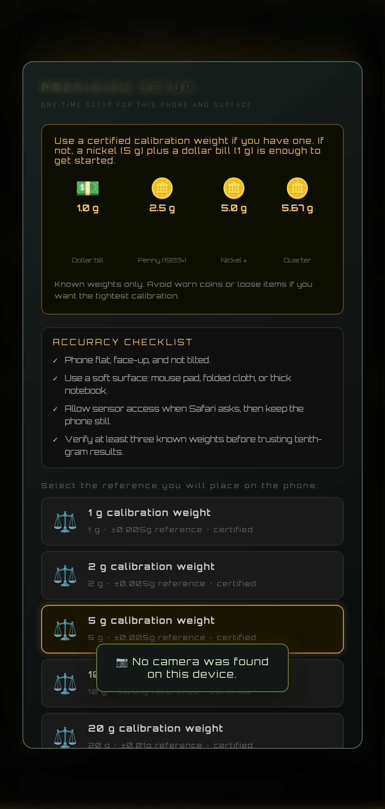

# PhoneWeigh

<!-- showcase:start -->
**A tilt-based digital scale that runs in your phone’s browser and only claims the accuracy it has measured.**

[](https://phoneweigh-ecru.vercel.app) [](LICENSE)



**Live demo:** https://phoneweigh-ecru.vercel.app

### Highlights

- Installable, offline-capable PWA in vanilla ES modules: zero runtime dependencies, no build step
- Known-weight calibration fitted to your specific phone and surface
- On-device Verification Ledger; numeric accuracy claims stay hidden until five verification runs are complete
- Ledger diagnostics: signed bias, MAE, RMSE, worst error, exportable snapshot

**Tech stack:** Vanilla JavaScript (ES modules), Web APIs (DeviceMotion, Service Worker, Web App Manifest), Vitest, Vercel

**Run locally:**

```bash
npm ci
npm run serve   # local static server
npm test        # unit tests
```

<!-- showcase:end -->


**A tilt-based digital precision scale that runs in your phone's browser — and tells you the truth about its own accuracy.**

PhoneWeigh measures weight by the deflection of the phone's gravity axis when a load presses on it. **Display resolution: 0.1g.** Measured accuracy is **whatever your Verification Ledger proves on this device and surface**. A numeric accuracy claim is withheld until five verification runs are complete.

## What it is

- Installable, offline-capable PWA (vanilla ES modules, **zero dependencies, no build step**).
- Calibrate with a known weight → the app fits a deflection curve for your specific phone + surface.
- Verify with reference weights → each result is recorded in the on-device **Verification Ledger** (`localStorage: phoneway_v5_ledger`).
- Every ±Xg claim in the app = worst measured |error| of a complete 5-verification window, rounded up to the next 0.1g. No heuristics, no marketing.
- Ledger diagnostics include signed bias, mean absolute error, RMSE, worst error, readiness state, and an exportable snapshot.

## The foundation layer

| Piece | What it does |
|---|---|
| `config/continuity.toml` | App identity, channel orchestration (calibrate / verify / diagnose / extend), honesty policy flags |
| `skills/` | Four agent-facing contracts: `calibrate`, `verify`, `diagnose`, `extend-channel` |
| `js/verificationLedger.js` | The honesty engine — the only source of accuracy claims |
| `scripts/check-static.mjs` | CI integrity gate: references exist, import graph resolves, version coherent |

New measurement paths plug in per **`skills/extend-channel/SKILL.md`** — same ledger, same claim discipline.

## What changed in v5

- Deleted dead sensor/NN claims that were not connected to the live measurement path.
- Fixed a fusion-units bug: orientation tilt (degrees) was averaged into acceleration (m/s²).
- Accuracy claims are evidence-based and ledger-derived.
- Numeric accuracy stays **UNVERIFIED** until the full verification window is complete.
- Verification pass/fail uses the reference's actual tolerance.
- CI runs unit, static-integrity, accuracy, Python, browser E2E, Lighthouse, dependency audit, and secret scan gates.

## Develop

```bash
npm ci
npm test
npm run check
npm run test:accuracy
npm run serve
```

## Docs

- `ACCURACY_FEATURES.md`
- `docs/PRD-tenth-gram-accuracy.md`
- `docs/PLAN-tenth-gram-accuracy.md`
- `docs/NEXT-30-PRS.md`
- `CLAUDE.md`
- `AGENTS.md`

## Honest limitations

- Tilt scales measure **deflection**, not mass directly — surface, case, temperature, and placement all matter.
- 0.1g is the display step, not a guaranteed physical accuracy.
- The ledger starts empty on every device. Until five valid verification runs are complete, accuracy remains **UNVERIFIED**.
